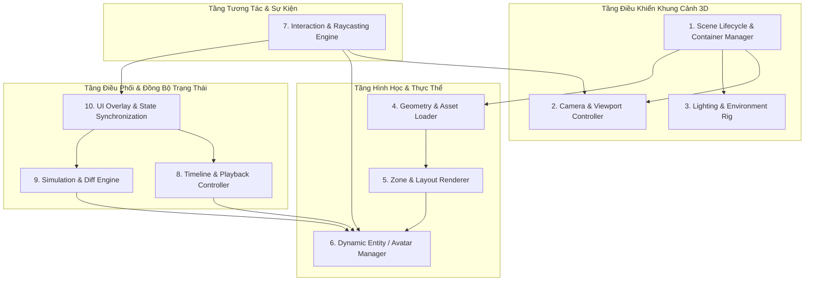

# KIẾN TRÚC TRỰC QUAN HÓA DIGITAL TWIN (ARC-001)
## THIẾT KẾ PHÂN TẦNG 10 TRÁCH NHIỆM KỸ THUẬT & ARCHITECTURAL DECISION RECORDS (ADRs)

---

## 1. TỔNG QUAN KIẾN TRÚC TẦNG TRỰC QUAN HÓA (VISUALIZATION LAYER)
Hệ thống trực quan hóa 3D của ShiftSync được thiết kế theo mô hình lai (Hybrid Architecture):
- **Tầng Giao diện Người dùng (UI Layer):** Sử dụng React 18 với các Component chức năng (Functional Components), Tailwind CSS, Lucide Icons, và Zustand State Management.
- **Tầng Đồ họa Không gian 3D (Spatial Engine):** Sử dụng Three.js thuần túy (Vanilla Three.js) được đóng gói bên trong React Hook Lifecycle (`useEffect` / `useRef`), tối ưu hóa để kiểm soát trực tiếp chu kỳ vẽ (Render Loop), tốc độ khung hình (FPS) và giải phóng bộ nhớ đồ họa WebGL.

---

## 2. PHÂN TÁCH 10 TRÁCH NHIỆM KỸ THUẬT (10 CORE RESPONSIBILITIES)

### 2.1. Trách nhiệm 1 — Scene Lifecycle & Container Management
- **Thực thi:** `SpatialWorkspace.jsx` (Mount hook, ResizeObserver, Canvas DOM Ref).
- **Nhiệm vụ:** Tạo và quản lý vòng đời của `THREE.Scene`, `THREE.WebGLRenderer`, `ResizeObserver`. Khởi tạo và ngắt `requestAnimationFrame`. Thực hiện dọn dẹp đệ quy toàn bộ GPU buffer khi unmount.

### 2.2. Trách nhiệm 2 — Camera & Viewport Controller
- **Thực thi:** `CameraController.js`, `CameraModes.js`.
- **Nhiệm vụ:** Quản lý `PerspectiveCamera` và `OrbitControls`. Cung cấp các hàm bay chuyển cảnh mượt mà (`flyTo`), chuyển đổi linh hoạt giữa 2 chế độ camera chính (*Overview Perspective* và *Top-Down Orthographic/Plan View*), và cơ chế bám theo nhân viên (*Follow Employee*).

### 2.3. Trách nhiệm 3 — Lighting & Environment Rig
- **Thực thi:** `SpatialWorkspace.jsx` (Dòng 956–983).
- **Nhiệm vụ:** Thiết lập hệ thống chiếu sáng ba điểm chuẩn mực (HemisphereLight cho ánh sáng môi trường mềm mại, DirectionalLight chính đổ bóng mềm PCFSoftShadowMap, và FillLight bù sáng góc khuất), tạo hiệu ứng thị giác ấm áp, phong cách đồ họa stylized thân thiện.

### 2.4. Trách nhiệm 4 — Geometry & Asset Loader
- **Thực thi:** `CharacterGeometries.js`, `FurnitureBuilder.js`, `StoreEnvironment.js`.
- **Nhiệm vụ:** Khởi tạo các khối hình học cơ bản (Procedural Primitives: Box, Cylinder, Extrude, RoundedRect, Ring). Lưu trữ cache các cấu trúc geometry tái sử dụng để giảm tải CPU-to-GPU memory transfer.

### 2.5. Trách nhiệm 5 — Zone & Layout Renderer
- **Thực thi:** `ZoneDecals.js`, `FurnitureBuilder.js`.
- **Nhiệm vụ:** Chuyển đổi tọa độ cửa hàng sang hệ tọa độ Three.js (`toThreeCoords`), vẽ decal mặt sàn thể hiện phạm vi khu vực, dựng nội thất đại diện cho từng loại nghiệp vụ, và dựng billboard tag sprite hiển thị định biên nhân sự.

### 2.6. Trách nhiệm 6 — Dynamic Entity (Staff/Avatar) Manager
- **Thực thi:** `StylizedAvatars.js`.
- **Nhiệm vụ:** Quản lý vòng đời của các Avatar nhân viên trong ca: tạo mới, định danh theo `staffId`, cập nhật trạng thái di chuyển bước chân (Walking Animation State Machine), trạng thái làm việc (Working Idle), và điều chỉnh mức độ chi tiết đồ họa theo khoảng cách (Dynamic LOD).

### 2.7. Trách nhiệm 7 — Interaction & Raycasting Engine
- **Thực thi:** `SpatialWorkspace.jsx` (Dòng 1036–1084), `DragTransfer.js`.
- **Nhiệm vụ:** Lắng nghe các sự kiện chuột/chạm (`pointerdown`, `pointermove`, `pointerup`), chuyển đổi tọa độ con trỏ sang Normal Device Coordinates (NDC), bắn tia `THREE.Raycaster` để nhận diện đối tượng được click (Zone hoặc Nhân viên) hoặc xử lý kéo thả di chuyển vị trí nhân sự trong không gian 3 chiều.

### 2.8. Trách nhiệm 8 — Timeline & Playback Controller
- **Thực thi:** `SpatialTimeline.jsx`, `SpatialWorkspace.jsx` (Temporal Staff Resolver).
- **Nhiệm vụ:** Điều khiển con trỏ thời gian (phút), tính toán nhân sự có mặt trong ca tại thời điểm hiện tại, phát lại tự động theo các mốc tốc độ (1x, 2x, 5x) và cập nhật dữ liệu đầu vào cho Entity Manager.

### 2.9. Trách nhiệm 9 — Simulation & Diff Engine
- **Thực thi:** `simulationStore.js`, `SimulationImpactCalculator.js`, `SimulationValidator.js`.
- **Nhiệm vụ:** Tách biệt môi trường mô phỏng (What-If Sandbox), tính toán chênh lệch (Diff List: TRANSFER, SWAP, REMOVE, ADD, AUTO_SCHEDULE), phân tích tác động vận hành (Operational Impact: % độ phủ, số zone thiếu hụt), và chuẩn bị dữ liệu cho quá trình đồng bộ backend.

### 2.10. Trách nhiệm 10 — UI Overlay & State Synchronization
- **Thực thi:** `CommandHeader.jsx`, `StaffingKpiBar.jsx`, `SpatialToolbar.jsx`, `SpatialInspector.jsx`, `SimulationBanner.jsx`.
- **Nhiệm vụ:** Hiển thị các bảng điều khiển giao diện nổi (HUD Overlays) bên trên WebGL Canvas, nhận tương tác của người dùng và đồng bộ hai chiều với Three.js Scene.

---

## 3. ARCHITECTURAL DECISION RECORDS (ADRs)

### ADR-01: Direct Three.js Orchestration vs React-Three-Fiber (R3F) for Temporal/Simulation Digital Twin
- **Bối cảnh:** Trong repository tồn tại cả mã nguồn Three.js trực tiếp (`SpatialWorkspace.jsx`) và R3F (`StoreScene.jsx`). Cần xác định chuẩn kiến trúc cho tính năng Digital Twin chính.
- **Quyết định:** Sử dụng **Vanilla Three.js (Direct Three.js)** cho tính năng điều phối vận hành `SpatialWorkspace.jsx`.
- **Lý do:**
  1. *Hiệu năng:* Timeline Scrubbing yêu cầu cập nhật vị trí và trạng thái của hàng chục nhân viên với tần số 60 Hz mà không muốn kích hoạt React Re-render toàn bộ cây component.
  2. *Kiểm soát vòng đời WebGL:* Dễ dàng quản lý chính xác việc cấp phát và giải phóng VRAM, xử lý trực tiếp requestAnimationFrame.
  3. *Tương thích:* R3F tiếp tục được giữ nguyên cho `StoreScene.jsx` trong trang biên tập mặt bằng tĩnh của Admin (Store Layout Editor).

### ADR-02: Recursive WebGL Resource Disposal Protocol
- **Bối cảnh:** Khi người dùng thay đổi ca làm việc hoặc scrub timeline liên tục, các decal và billboard tag sprite được sinh mới, gây rò rỉ VRAM nếu không dispose đúng cách.
- **Quyết định:** Thiết lập quy chuẩn dọn dẹp đệ quy bắt buộc `disposeHierarchy(obj)`:
  - Duyệt qua toàn bộ cây con của Object3D.
  - Gọi `.geometry.dispose()` nếu tồn tại hình học.
  - Duyệt qua toàn bộ material (kể cả mảng material), gọi `.material.dispose()`.
  - Duyệt qua các map texture gắn với material (đặc biệt là CanvasTexture của Billboard Tags) và gọi `.dispose()`.
- **Hệ quả:** Triệt tiêu hoàn toàn hiện tượng tụt FPS và rò rỉ bộ nhớ sau nhiều giờ sử dụng liên tục.

### ADR-03: Optimistic What-If Simulation Store with Atomic Backend Reconciliation
- **Bối cảnh:** Thao tác kéo thả điều chuyển nhân viên yêu cầu phản hồi tức thời trên giao diện nhưng việc lưu vào database cần đảm bảo tính toàn vẹn (ACID) và tránh xung đột với các quản lý khác.
- **Quyết định:** Sử dụng mô hình **Optimistic Local Simulation** kết hợp **Atomic Backend Reconciliation**:
  - Mọi thao tác kéo thả, đổi ca chỉ cập nhật vào Zustand Store và Three.js scene cục bộ.
  - Khi bấm "Áp dụng", hệ thống gửi batch requests xuống các endpoint có Transaction Boundary và Pessimistic Lock (`POST .../assignments/swap`).
  - Nếu gặp lỗi, hệ thống bảo toàn trạng thái mô phỏng trên màn hình để người dùng có thể thử lại, không để xảy ra tình trạng "mất trắng dữ liệu đã chỉnh sửa".
