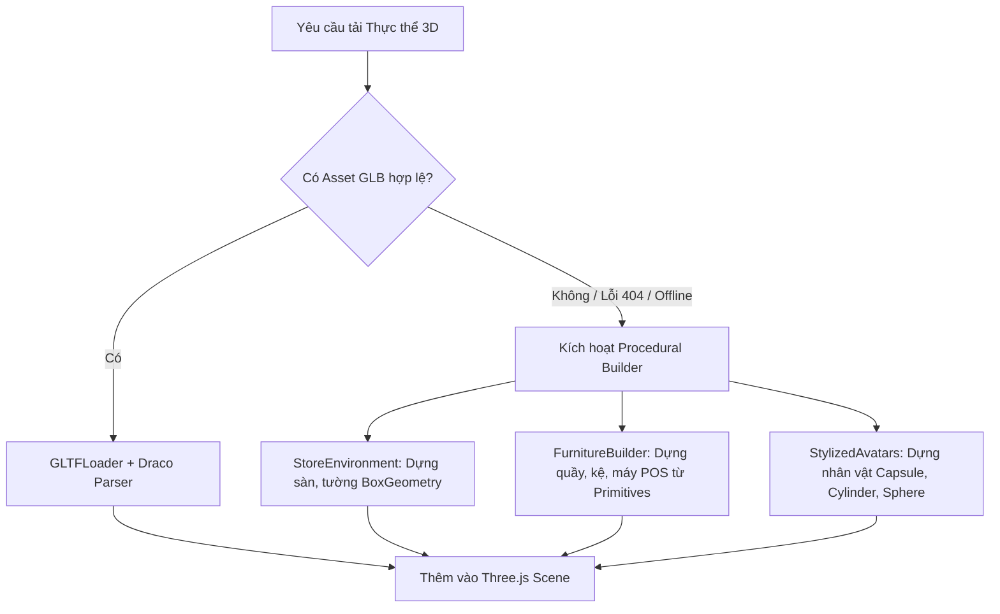

# QUY CHUẨN KỸ THUẬT TÀI NGUYÊN 3D GLB/GLTF & PROCEDURAL FALLBACK (ARC-002)
## SHIFTSYNC DIGITAL TWIN — TIÊU CHUẨN ASSET 3D VÀ HỆ THỐNG SINH HÌNH HỌC DỰ PHÒNG

---

## 1. MỤC TIÊU VÀ ĐỊNH HƯỚNG THIẾT KẾ
Nhằm đảm bảo ShiftSync Digital Twin vừa có khả năng hiển thị các mô hình 3D thực tế chi tiết (CAD/BIM hoặc 3D Artist assets) trong tương lai, vừa hoạt động nhẹ nhàng, tức thì (zero-download-lag) và không bao giờ bị gián đoạn hoạt động (zero-crash) trên các thiết bị phổ thông của người quản lý cửa hàng, tài liệu này quy chuẩn hóa:
1. Quy chuẩn kỹ thuật cho file mô hình 3D ngoại vi định dạng GLTF/GLB.
2. Cơ chế sinh hình học tự động theo thuật toán (Procedural Geometry Fallback Hierarchy).

---

## 2. QUY CHUẨN KỸ THUẬT TÀI NGUYÊN 3D (3D ASSET SPECIFICATION)

### 2.1. Định dạng Tệp tin & Nén (File Format & Compression)
- **Định dạng chuẩn:** **GLTF 2.0 Binary (`.glb`)**. Định dạng này đóng gói toàn bộ cấu trúc mesh, bones, animation, và textures vào một file nhị phân duy nhất, giảm thiểu tối đa số lượng HTTP request.
- **Thuật toán nén:** Sử dụng **Draco Mesh Compression** (nén hình học) và **KTX2 / Basis Universal** (nén texture trực tiếp vào bộ nhớ GPU) khi xuất file từ Blender / 3ds Max / Maya.

### 2.2. Ngân sách Hình học và Hiệu năng (Polygon & Vertex Budgets)

| Loại Thực thể 3D | Ngân sách Tam giác (Max Triangles) | Kích thước Texture tối đa | Giới hạn Bone / Rig |
| :--- | :---: | :---: | :---: |
| **Toàn bộ Khung cảnh Cửa hàng (Store Environment)** | 50,000 tris | 2048 x 2048 px (Atlas) | Không có rig |
| **Khu vực / Cụm Nội thất (Zone Furniture Module)** | 1,500 – 3,000 tris | 1024 x 1024 px | Không có rig |
| **Nhân vật Nhân viên (Staff Avatar)** | 2,500 – 4,000 tris | 512 x 512 px | 24 – 32 bones (Humanoid) |
| **Vật phẩm nhỏ (Props: Ly cafe, Máy POS, Máy tính)** | 300 – 800 tris | Dùng chung Palette Texture | Không có rig |

### 2.3. Quy ước Kích thước & Hệ Tọa độ (Scale & Coordinate Conventions)
- **Tỷ lệ chuẩn:** **1 Three.js Unit = 1 Mét thực tế**.
- **Hệ tọa độ:** Trục Y hướng lên trên (Up-axis: `+Y`), mặt sàn nằm tại cao độ `Y = 0`. Trục X đại diện cho Chiều dài (Length), trục Z đại diện cho Chiều rộng (Width).
- **Điểm gốc (Origin/Pivot):**
  - Đối với nhân vật (Avatar): Gốc tọa độ nằm tại chính giữa 2 bàn chân trên mặt đất `(0, 0, 0)`.
  - Đối với nội thất/thiết bị: Gốc tọa độ nằm tại đáy trọng tâm tiếp xúc mặt sàn.

### 2.4. Vật liệu & Chiếu sáng (PBR Materials)
- Sử dụng chuẩn `MeshStandardMaterial` hỗ trợ vật lý chân thực (PBR):
  - `map` (Albedo / Base Color)
  - `roughness` (Độ nhám bề mặt: 0.6 – 0.8 cho sàn gạch, gỗ; 0.2 – 0.4 cho kim loại máy pha cà phê)
  - `metalness` (0.0 cho vật liệu phi kim loại, 0.8 – 1.0 cho thiết bị inox)

---

## 3. HỆ THỐNG PROCEDURAL GEOMETRY FALLBACK (KIẾN TRÚC HIỆN TẠI)

Để đảm bảo phần mềm hoạt động ổn định 100% trong môi trường intranet hoặc khi kết nối mạng chậm, ShiftSync triển khai toàn bộ giao diện bằng **Procedural Geometry Engine** (không phụ thuộc vào việc tải file `.glb` từ CDN):

### 3.1. Procedural Store Environment (`StoreEnvironment.js`)
- Dựng sàn bằng `THREE.PlaneGeometry` với vật liệu gạch men hoa văn nhẹ nhàng.
- Dựng tường bao bằng các khối `THREE.BoxGeometry` có gắn cờ `userData.isWall` để hỗ trợ chế độ trong suốt X-Ray và ẩn hiện layer.
- Hệ thống đèn thả trần (Pendant Lamps) tự đung đưa nhẹ theo hàm lượng giác `Math.sin(elapsedTime)` tạo cảm giác không gian sống động.

### 3.2. Procedural Furniture theo Phân loại Zone (`FurnitureBuilder.js`)
Dựa vào tên và mã của từng Zone trong cơ sở dữ liệu (`StoreZone.name`), hệ thống tự động sinh cụm nội thất tương ứng:
- **Zone Thu ngân (Cashier):** Quầy gỗ hình chữ L, màn hình POS cảm ứng, máy in hóa đơn.
- **Zone Pha chế (Barista / Bar):** Quầy pha chế inox, máy pha espresso hai vòi kèm hiệu ứng hạt khói hơi nước bốc lên nhẹ nhàng (`steamParticles`).
- **Zone Bếp (Kitchen):** Bàn sơ chế, chậu rửa, bếp từ.
- **Zone Kho (Storage / Warehouse):** Kệ hàng kim loại 3 tầng chứa các thùng carton.
- **Zone Phục vụ / Bàn ăn (Dining):** Bàn tròn kèm các ghế tựa nhỏ.

### 3.3. Procedural Stylized Avatars (`StylizedAvatars.js`)
- Mô phỏng nhân sự bằng các khối hình học Stylized Low-poly được tối ưu hóa:
  - Đầu (Head): Khối hộp bo góc hoặc hình cầu cách điệu, có nón/mũ đồng phục.
  - Thân (Torso): Khối hộp cách điệu khoác tạp dề (Apron) mang màu sắc đại diện cho kỹ năng nhân viên.
  - Chân & Tay: Khối trụ (Cylinder) được gắn liên kết vào animation controller để thực hiện bước chân đong đưa khi di chuyển (Walking Transition).
  - Tên và Kỹ năng: Billboard Sprite canvas hiển thị rõ ràng trên đỉnh đầu.

---

## 4. KẾT LUẬN
Nhờ thiết kế kép: vừa tuân thủ chặt chẽ tiêu chuẩn file ngoại vi **GLTF/GLB**, vừa sở hữu bộ công cụ sinh hình học theo thuật toán **Procedural Fallback** toàn diện, hệ sinh thái Digital Twin của ShiftSync đạt độ tin cậy tuyệt đối: tải trang tức thì (< 100ms), không lo rủi ro tệp tin bị hỏng (corrupted assets), và sẵn sàng mở rộng đón nhận các mô hình 3D thực tế cao cấp trong tương lai.
