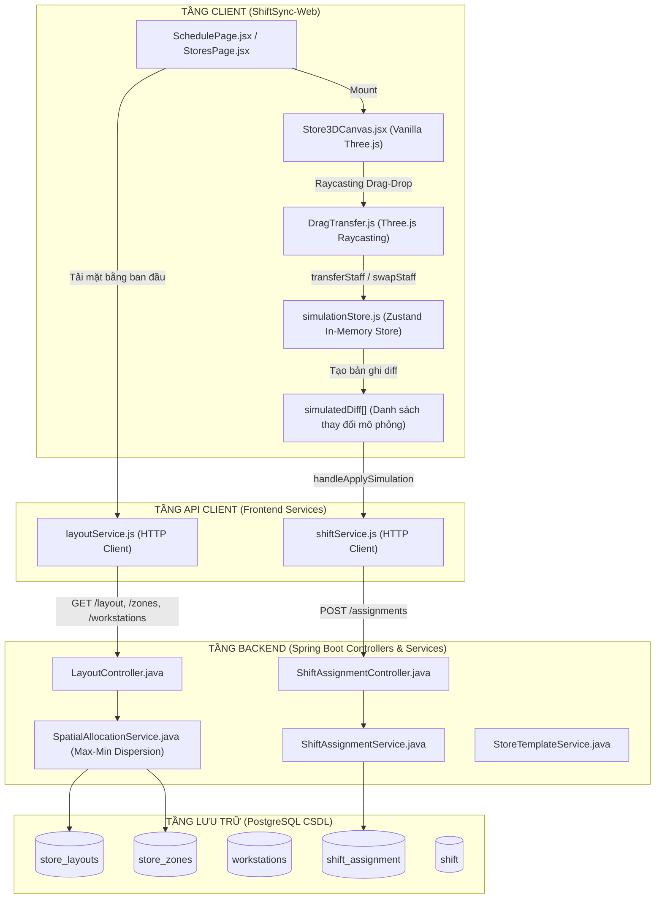
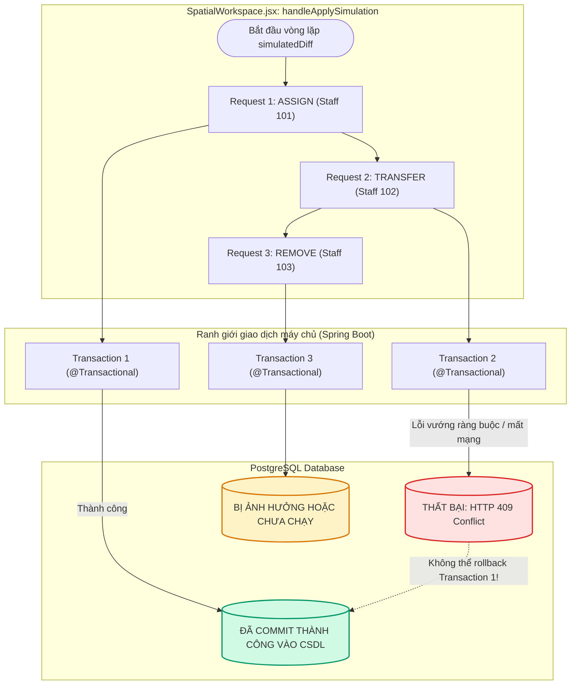
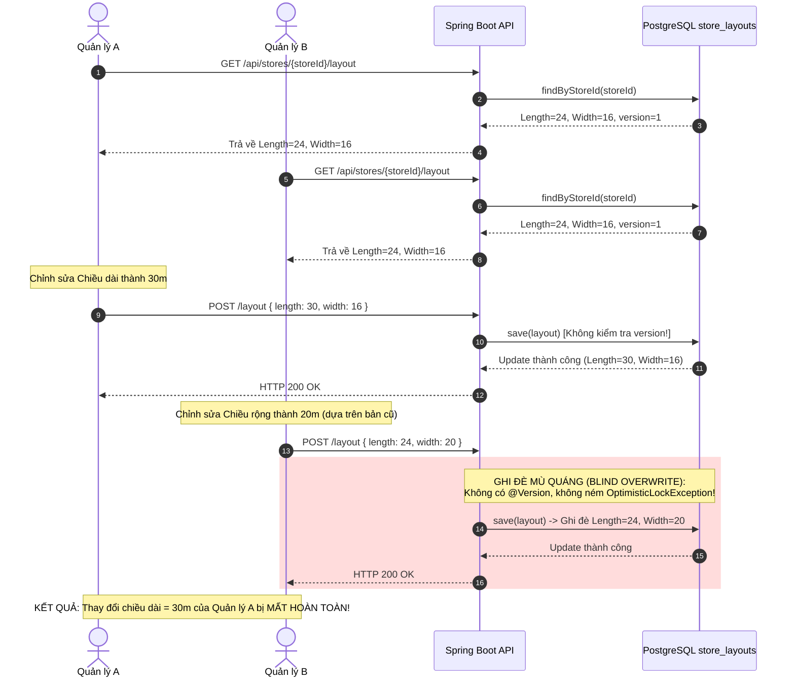
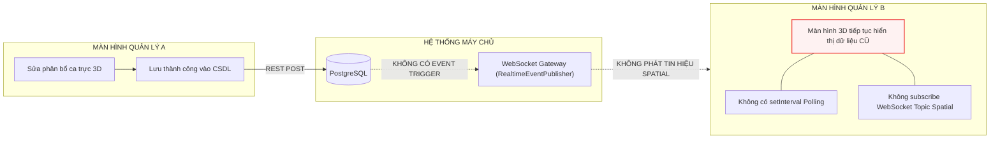

# BẢN ĐỒ PHỤ THUỘC & LUỒNG DỮ LIỆU ĐỒNG THỜI (AUD-001.2 FLOW MAP)
## Kiến trúc luồng yêu cầu, Ranh giới giao dịch & Điểm đứt gãy luồng dữ liệu 3D Digital Twin
**Kho mã nguồn:** ShiftSync (`shiftsync-backend` & `ShiftSync-Web`)  
**Thời điểm lập:** 2026-10-13  
**Vai trò kiểm toán:** Senior Software Architect, Concurrency Auditor & Evidence Verifier  
**Nguyên tắc:** Read-Only Audit (Chỉ vẽ các luồng thực tế đã được kiểm chứng bằng mã nguồn, đánh dấu rõ ràng các điểm đứt gãy và lỗi thiết kế)

---

## 1. Sơ đồ tổng thể phân tầng trạng thái Digital Twin (Overall State Layers)



---

## 2. Luồng thực thi chi tiết & Điểm gãy P0 khi Áp dụng mô phỏng (Simulation Apply Flow)

Sơ đồ tuần tự thể hiện chính xác lỗi **P0 (`FIND-01`)** xảy ra khi quản lý kéo thả nhân sự giữa các phân khu 3D rồi nhấn "Áp dụng":

```mermaid
sequenceDiagram
    autonumber
    actor Manager as Quản lý cửa hàng (Manager)
    participant UI as SpatialWorkspace.jsx
    participant Store as simulationStore.js (Zustand)
    participant API as shiftService.js
    participant Controller as ShiftAssignmentController
    participant Service as ShiftAssignmentService
    participant DB as PostgreSQL (shift_assignment)

    Manager->>UI: Kéo nhân viên từ Phân khu A sang B
    UI->>Store: transferStaff(staffId, targetZone)
    Store-->>Store: Cập nhật simulatedStaff & tạo diff 'TRANSFER'
    Note over Store: diff = { type: 'TRANSFER', staffId, toZoneId: 'zone-B-uuid' }
    
    Manager->>UI: Bấm "Xác nhận lưu thay đổi" (handleApplySimulation)
    
    rect rgb(255, 230, 230)
        Note over UI,API: ĐIỂM ĐỨT GÃY P0: Dòng 795 gọi assignStaffToShift thiếu tham số zoneId!
        UI->>API: assignStaffToShift(storeId, shiftId, staffId) [zoneId bị undefined]
        API->>Controller: POST /api/stores/{storeId}/shifts/{shiftId}/assignments<br/>Payload: { staffId: "..." } (KHÔNG CÓ zoneId!)
    end

    Controller->>Service: assignStaffToShift(storeId, shiftId, staffId, null, false)
    
    Service->>DB: findByShiftIdAndStaffId(shiftId, staffId)
    DB-->>Service: Trả về bản ghi ShiftAssignment hiện có (Đã có trong ca)
    
    rect rgb(255, 200, 200)
        Note over Service: requestedZoneId == null && existingOpt.isPresent()
        Service-->>Controller: throw BusinessException("Staff is already assigned to this shift", CONFLICT)
        Controller-->>API: HTTP 409 Conflict
        API-->>UI: Promise Rejection (HTTP 409)
    end

    rect rgb(255, 240, 200)
        Note over UI: Dòng 796: catch (e) { console.warn('Transfer API:', e.message); }<br/>LỖI BỊ NUỐT HOÀN TOÀN!
        UI->>Store: exitSimulation() (Hủy bỏ toàn bộ trạng thái thử nghiệm)
        UI->>API: onApplyComplete() -> Tải lại danh sách ca từ máy chủ
        API-->>UI: Dữ liệu ca cũ (Nhân viên vẫn ở phân khu cũ)
    end
    Note over Manager,UI: KẾT QUẢ: Quản lý thấy nhân viên nhảy ngược về chỗ cũ, dữ liệu không đổi!
```

---

## 3. Ranh giới giao dịch & Phân mảnh dữ liệu khi gặp lỗi (Transaction Boundary Gap)

Sơ đồ minh họa rủi ro **P1 (`FIND-03`)**: Vòng lặp gửi tuần tự từng request HTTP độc lập thay vì một Batch Transaction nguyên tử:



---

## 4. Xung đột đồng thời & Thiếu khóa phiên bản (Concurrency & Versioning Gap)

Sơ đồ minh họa rủi ro **Lost Update (`CONC-001`, `CONC-002`)**:



---

## 5. Khoảng trống thời gian thực giữa nhiều Quản lý (Multi-Manager Blindness)

Sơ đồ minh họa rủi ro **Multi-Manager Blindness (`CONC-009`)**:


