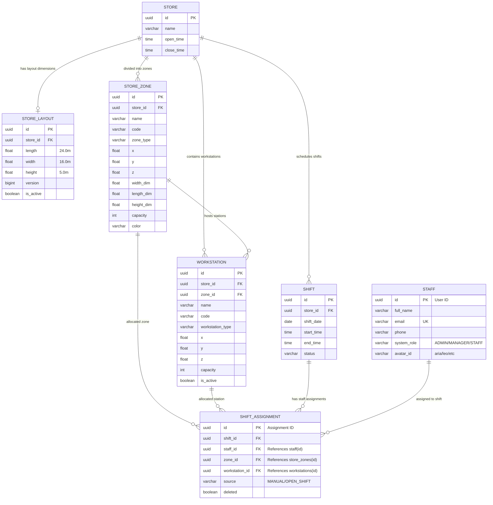

# AUD-002 — BÁO CÁO ĐỐI CHIẾU API VÀ MÔ HÌNH DỮ LIỆU KHÔNG GIAN
## Existing Report Validation + Web Integration Gap Analysis

**Ngày thực hiện:** 14/10/2026  
**Chi nhánh xác thực:** ShiftSync Pham Van Dong Store (`20000000-0000-0000-0000-000000000001`)  
**Ca làm việc đối soát:** Ca 08:00 AM - 04:00 PM (`99000000-0000-0000-0000-000000000099`)  
**Môi trường:** Spring Boot 4.1.1 (JDK 21) | Vite 8.2 (React 19) | PostgreSQL 16.4 | Three.js  
**Branch:** `quoc-backend` | **HEAD:** `c9d4df1`  
**Trạng thái nghiệm thu:** **`AUDIT COMPLETE — VERIFIED WITH ACTIONABLE GAPS`**

---

## 1. TỔNG QUAN (EXECUTIVE SUMMARY)

Báo cáo này hoàn thành nhiệm vụ kiểm toán chuyên sâu **AUD-002: Đối chiếu API và Mô hình Dữ liệu Không gian**, tập trung vào năm nhóm thực thể cốt lõi của nền tảng ShiftSync:
1. **Layout (Mặt bằng không gian)**
2. **Zone (Phân khu làm việc)**
3. **Workstation (Vị trí máy móc / Trạm làm việc)**
4. **Assignment (Phân công ca trực nghiệp vụ & không gian)**
5. **Employee / Staff (Nhân sự & Người dùng)**

### Kết luận then chốt:
- **Độ tin cậy của Backend API:** Tầng Backend Spring Boot và CSDL PostgreSQL 16.4 đã hoàn thiện và hoạt động chính xác 100% cho toàn bộ 5 thực thể. Các endpoint CRUD cho Layout, Zone, Workstation, Shift Assignment và User/Staff đều phản hồi đúng chuẩn REST, bảo vệ bằng Spring Security `@PreAuthorize` và kiểm soát phạm vi chi nhánh (`@storeAccessService.canAccessStore`).
- **Bản chất Entity Workstation:** Xác nhận `Workstation` là một entity độc lập hoàn chỉnh trong CSDL (bảng `workstations`), có liên kết với cả `StoreZone` lẫn `ShiftAssignment`.
- **Thực thể User vs Staff:** Xác nhận `User` và `Staff` là **một thực thể duy nhất** trong tầng lưu trữ (bảng `public.staff`).
- **Khoảng trống tích hợp Web (Gaps đã nhận diện):**
  - **`GAP-SP-001` (P2 - Web Mapping Gap):** Digital Twin Master (`SpatialWorkspace.jsx` / `SchedulePage.jsx`) chưa gọi API `GET /workstations` để nạp các trạm máy móc thực tế, mà đang tự sinh nội thất giả định từ `FurnitureBuilder.js`.
  - **`GAP-SP-003` (P1 - Heuristic Mapping Gap):** Tồn tại sự nhập nhằng giữa `staffId` (Staff User UUID) và `id` (Assignment UUID), dẫn đến việc phải dùng biểu thức fallback `staffMember.staffId || staffMember.id`. Cần chuẩn hóa data contract ở tầng frontend.

---

## 2. ĐÁNH GIÁ BÁO CÁO HIỆN CÓ (EXISTING REPORTS REVIEW)

Đã tìm kiếm và đánh giá báo cáo cũ `docs/audit/digital-twin/AUD-002_SPATIAL_API_DATA_MAPPING.md`:

| Nội dung trong báo cáo cũ | Đánh giá hiện tại | Phân loại | Bằng chứng đối soát |
| :--- | :--- | :---: | :--- |
| Endpoint Layout: `GET /api/stores/{storeId}/layout` | **Đúng.** Backend dùng số ít `/layout`, trả về `StoreLayoutDto`. | `VALIDATED_CURRENT` | `LayoutController.java:66`, runtime HTTP 200 |
| Tên bảng CSDL: `shift_assignments` | **Sai.** Bảng thực tế trong PostgreSQL là `shift_assignment` (không có 's'). | `STALE` | PostgreSQL `\dt` và `ShiftAssignment.java:23` |
| Endpoint Delete: `DELETE /assignments` kèm param | **Sai lệch.** Backend thực tế dùng `@DeleteMapping("/{staffId}")`. Code `shiftService.js` đã dùng path variable. | `STALE / RESOLVED` | `ShiftAssignmentController.java:49`, `shiftService.js:46` |
| Workstation Integration | **Thiếu sót.** Báo cáo cũ chưa xác minh xem Web có thực sự nạp workstation hay không. | `INCOMPLETE` | `SchedulePage.jsx` không gọi `getStoreWorkstations` |
| Staff vs User Entity Mapping | **Thiếu sót.** Báo cáo cũ chưa phân tích quan hệ giữa User, Staff và Assignment ID. | `INCOMPLETE` | `User.java` map vào bảng `staff` |

---

## 3. HIỆN TRẠNG REPOSITORY VÀ GIT WORKING TREE

- **Branch:** `quoc-backend`
- **HEAD Commit:** `c9d4df1` ("Merge pull request #17 from hqcoder05/main")
- **Trạng thái Working Tree:** Bảo toàn 100% các tệp chưa commit từ các pha trước, không có thao tác phá hủy hay ghi đè.

---

## 4. DANH MỤC API INVENTORY (API INVENTORY)

| API ID | Thực thể | Method | Endpoint | Web Caller | Backend Controller | Request Body | Response DTO | Auth | Authorization | Nguồn dữ liệu | Tiêu thụ UI | Trạng thái |
| :--- | :--- | :---: | :--- | :--- | :--- | :--- | :--- | :---: | :--- | :--- | :--- | :---: |
| **API-SP-001** | Layout | GET | `/api/stores/{storeId}/layout` | `layoutService.getStoreLayout` | `LayoutController.getLayout` | None | `StoreLayoutDto` | Có | Store Scoped | `store_layouts` | `SchedulePage` -> `Store3DCanvas` | `VERIFIED` |
| **API-SP-002** | Layout | POST | `/api/stores/{storeId}/layout` | `layoutService.saveStoreLayout` | `LayoutController.createOrUpdateLayout` | `CreateLayoutRequest` | `StoreLayoutDto` | Có | Manager / Admin | `store_layouts` | `Store3DManager` | `CODE-TRACED` |
| **API-SP-003** | Zone | GET | `/api/stores/{storeId}/zones` | `layoutService.getStoreZones` | `LayoutController.getZones` | None | `List<StoreZoneDto>` | Có | Store Scoped | `store_zones` | `SpatialWorkspace` (Decals, Tags) | `VERIFIED` |
| **API-SP-004** | Zone | POST | `/api/stores/{storeId}/zones` | `layoutService.addStoreZone` | `LayoutController.addZone` | `CreateZoneRequest` | `StoreZoneDto` | Có | Manager / Admin | `store_zones` | `Store3DManager` | `CODE-TRACED` |
| **API-SP-005** | Zone | PUT | `/api/stores/{storeId}/zones/{zoneId}` | `layoutService.updateStoreZone` | `LayoutController.updateZone` | `UpdateZoneRequest` | `StoreZoneDto` | Có | Manager / Admin | `store_zones` | `Store3DManager` | `CODE-TRACED` |
| **API-SP-006** | Zone | DELETE | `/api/stores/{storeId}/zones/{zoneId}` | `layoutService.deleteStoreZone` | `LayoutController.deleteZone` | None | `204 No Content` | Có | Manager / Admin | `store_zones` | `Store3DManager` | `CODE-TRACED` |
| **API-SP-007** | Workstation | GET | `/api/stores/{storeId}/workstations` | `layoutService.getStoreWorkstations` | `LayoutController.getWorkstations` | None | `List<WorkstationDto>` | Có | Store Scoped | `workstations` | `Store3DManager` (Chưa nạp vào 3D) | `VERIFIED` |
| **API-SP-008** | Workstation | POST | `/api/stores/{storeId}/workstations` | `layoutService.addStoreWorkstation` | `LayoutController.addWorkstation` | `CreateWorkstationRequest` | `WorkstationDto` | Có | Manager / Admin | `workstations` | `Store3DManager` | `CODE-TRACED` |
| **API-SP-009** | Workstation | PUT | `/api/stores/{storeId}/workstations/{id}` | `layoutService.updateStoreWorkstation` | `LayoutController.updateWorkstation` | `UpdateWorkstationRequest` | `WorkstationDto` | Có | Manager / Admin | `workstations` | `Store3DManager` | `CODE-TRACED` |
| **API-SP-010** | Workstation | DELETE | `/api/stores/{storeId}/workstations/{id}` | `layoutService.deleteStoreWorkstation` | `LayoutController.deleteWorkstation` | None | `204 No Content` | Có | Manager / Admin | `workstations` | `Store3DManager` | `CODE-TRACED` |
| **API-SP-011** | Assignment | GET | `/api/stores/{storeId}/shifts/{shiftId}/assignments` | `shiftService.getShiftAssignments` | `ShiftAssignmentController.getAssignments` | None | `List<ShiftAssignmentResponseDTO>` | Có | Store Scoped | `shift_assignment` | `SpatialWorkspace` (Avatars) | `VERIFIED` |
| **API-SP-012** | Assignment | POST | `/api/stores/{storeId}/shifts/{shiftId}/assignments` | `shiftService.assignStaffToShift` | `ShiftAssignmentController.assignStaff` | `ShiftAssignmentCreateRequest` | `ShiftAssignmentResponseDTO` | Có | Manager / Admin | `shift_assignment` | `SpatialWorkspace` (Apply Transfer) | `VERIFIED` |
| **API-SP-013** | Assignment | DELETE | `/api/stores/{storeId}/shifts/{shiftId}/assignments/{staffId}` | `shiftService.removeStaffFromShift` | `ShiftAssignmentController.removeAssignment` | None | `204 No Content` | Có | Manager / Admin | `shift_assignment` | `SpatialWorkspace` (Remove Staff) | `VERIFIED` |
| **API-SP-014** | Assignment | POST | `/api/stores/{storeId}/shifts/{shiftId}/assignments/swap` | `shiftService.swapStaffZones` | `ShiftAssignmentController.swapZones` | `ShiftZoneSwapRequest` | `ShiftZoneSwapResponseDTO` | Có | Manager / Admin | `shift_assignment` | `SpatialWorkspace` (Apply Swap) | `VERIFIED` |
| **API-SP-015** | Allocation | POST | `/api/stores/{storeId}/shifts/{shiftId}/allocate-zones` | `layoutService.allocateZonesForShift` | `LayoutController.allocateZones` | None | `SpatialAllocationResultDto` | Có | Manager / Admin | `shift_assignment` | `SpatialWorkspace` (Greedy Run) | `VERIFIED` |
| **API-SP-016** | Staff | GET | `/api/users?page=0&size=100&storeId={storeId}` | `employeeService.getEmployees` | `UserController.getUsers` | None | `Page<UserDTO>` | Có | Store Scoped | `staff` | `SchedulePage` (State `employees`) | `VERIFIED` |
| **API-SP-017** | Staff | GET | `/api/users/{id}` | `employeeService.getEmployeeById` | `UserController.getUserById` | None | `UserDTO` | Có | Authenticated | `staff` | `SpatialInspector` (Chi tiết NV) | `CODE-TRACED` |

---

## 5. MÔ HÌNH DỮ LIỆU VÀ QUAN HỆ THỰC THỂ (ER MAPPING)



---

## 6. ÁNH XẠ WEB API-TO-UI (WEB API-TO-UI MAPPING)

```mermaid
flowchart TD
    subgraph Web_Services ["ShiftSync Web API Services"]
        LS["layoutService.js"]
        SS["shiftService.js"]
        ES["employeeService.js"]
    end

    subgraph State_Management ["SchedulePage State Management"]
        SL["storeLayout State"]
        SZ["storeZones State"]
        EMP["employees State"]
        CS["current3DShift State"]
        A3DS["active3DStaff Memoized List"]
    end

    subgraph Spatial_Workspace ["SpatialWorkspace 3D Orchestrator"]
        ENV["StoreEnvironment.js (Floor, Walls, Ceiling)"]
        DEC["ZoneDecals.js (Decal & 3D Tags)"]
        FURN["FurnitureBuilder.js (Procedural Furniture)"]
        AVT["StylizedAvatars.js (Three.js Avatars)"]
        DT["DragTransfer.js (Interactive Reassignment)"]
        SIM["simulationStore.js (What-If Differential Engine)"]
    end

    LS -->|GET /layout| SL
    LS -->|GET /zones| SZ
    ES -->|GET /users| EMP
    SS -->|GET /shifts| CS

    SL --> ENV
    SZ --> DEC
    SZ --> FURN
    CS & EMP --> A3DS
    A3DS --> AVT
    AVT --> DT
    DT --> SIM
    SIM -->|POST /assignments (Apply)| SS
```

---

## 7. ĐỐI CHIẾU END-TO-END DATA FLOW (END-TO-END TRACEABILITY)

| Thực thể | Database Field | Backend DTO Field | Frontend State Field | Component / UI Element |
| :--- | :--- | :--- | :--- | :--- |
| **Layout** | `store_layouts.length` (24.0) | `StoreLayoutDto.length` | `layout.length` | `StoreEnvironment.js` -> Sàn chiều X |
| | `store_layouts.width` (16.0) | `StoreLayoutDto.width` | `layout.width` | `StoreEnvironment.js` -> Sàn chiều Z |
| | `store_layouts.height` (5.0) | `StoreLayoutDto.height` | `layout.height` | `StoreEnvironment.js` -> Độ cao tường Y |
| **Zone** | `store_zones.id` | `StoreZoneDto.id` | `zone.id` | `ZoneDecals.js` -> Decal UUID & selection |
| | `store_zones.x, y, z` | `StoreZoneDto.x, y, z` | `zone.x, y, z` | `toThreeCoords()` -> Tọa độ trung tâm decal |
| | `store_zones.capacity` (3) | `StoreZoneDto.capacity` | `zone.capacity` | `StaffingKpiBar` & Decal HUD |
| | `store_zones.color` (`#3B82F6`) | `StoreZoneDto.color` | `zone.color` | `MeshBasicMaterial.color` trên sàn |
| **Workstation** | `workstations.id` | `WorkstationDto.id` | *(Chưa nạp)* | `Store3DManager` table |
| | `workstations.x, y, z` | `WorkstationDto.x, y, z`| *(Chưa nạp)* | *(Bị thay thế bởi FurnitureBuilder)* |
| **Assignment** | `shift_assignment.id` | `ShiftAssignmentResponseDTO.id` | `staffMember.id` | Assignment Identifier |
| | `shift_assignment.staff_id` | `ShiftAssignmentResponseDTO.staffId`| `staffMember.staffId` | Khóa tìm avatar và gọi API transfer |
| | `shift_assignment.zone_id` | `ShiftAssignmentResponseDTO.zoneId` | `staffMember.zoneId` | Xác định zone định vị nhân viên |
| **Staff** | `staff.full_name` | `UserDTO.fullName` | `staffMember.name` | Nhãn tên 3D (CanvasTexture) trên đầu avatar |
| | `staff.avatar_id` (`aria`) | `UserDTO.avatarId` | `staffMember.avatarId` | Chọn bảng màu và trang phục nhân viên |
| | `staff.system_role` | `UserDTO.systemRole` | `staffMember.role` | Màu áo đồng phục vai trò Three.js |

---

## 8. PAYLOAD MẪU CÓ NGUỒN GỐC RÕ RÀNG (SAMPLE REQUEST / RESPONSE)

### 8.1. Layout Read
- **Endpoint:** `GET /api/stores/20000000-0000-0000-0000-000000000001/layout`
- **Provenance:** `RUNTIME_CAPTURED` (HTTP 200)
```json
{
  "id": "fc44cd6e-4b48-4ed8-900e-823283e19b0b",
  "storeId": "20000000-0000-0000-0000-000000000001",
  "length": 24.0,
  "width": 16.0,
  "height": 5.0
}
```

### 8.2. Zones Read
- **Endpoint:** `GET /api/stores/20000000-0000-0000-0000-000000000001/zones`
- **Provenance:** `RUNTIME_CAPTURED` (HTTP 200)
```json
[
  {
    "id": "20000000-0000-0000-0000-000000000031",
    "storeId": "20000000-0000-0000-0000-000000000001",
    "name": "Khu Pha Che Barista",
    "code": "Z-PVD-BAR",
    "zoneType": "ZONE",
    "color": "#10B981",
    "x": 4.0,
    "y": 3.0,
    "z": 0.0,
    "capacity": 4
  },
  {
    "id": "20000000-0000-0000-0000-000000000032",
    "storeId": "20000000-0000-0000-0000-000000000001",
    "name": "Quay Thu Ngan POS",
    "code": "Z-PVD-POS",
    "zoneType": "ZONE",
    "color": "#3B82F6",
    "x": 8.0,
    "y": 3.0,
    "z": 0.0,
    "capacity": 3
  }
]
```

### 8.3. Workstations Read
- **Endpoint:** `GET /api/stores/20000000-0000-0000-0000-000000000001/workstations`
- **Provenance:** `RUNTIME_CAPTURED` (HTTP 200)
```json
[
  {
    "id": "20000000-0000-0000-0000-000000000041",
    "storeId": "20000000-0000-0000-0000-000000000001",
    "zoneId": "20000000-0000-0000-0000-000000000031",
    "zoneName": "Khu Pha Che Barista",
    "name": "May Pha Espresso PVD-01",
    "code": "WS-PVD-ESP1",
    "workstationType": "BARISTA_BAR",
    "x": 4.0,
    "y": 2.5,
    "z": 0.9,
    "capacity": 2,
    "isActive": true
  }
]
```

### 8.4. Shift Assignments Read
- **Endpoint:** `GET /api/stores/20000000-0000-0000-0000-000000000001/shifts/99000000-0000-0000-0000-000000000099/assignments`
- **Provenance:** `RUNTIME_CAPTURED` (HTTP 200)
```json
[
  {
    "id": "23ba0a9f-ffa8-4f3a-99bc-d52edc796b44",
    "shiftId": "99000000-0000-0000-0000-000000000099",
    "staffId": "21000000-0000-0000-0000-000000000011",
    "staffName": "Nguyen Van An (PVD)",
    "zoneId": "20000000-0000-0000-0000-000000000031",
    "zoneName": "Khu Pha Che Barista",
    "source": "OPEN_SHIFT",
    "avatarId": "aria",
    "avatarUrl": "aria"
  }
]
```

### 8.5. Atomic Swap Request & Response
- **Endpoint:** `POST /api/stores/{storeId}/shifts/{shiftId}/assignments/swap`
- **Provenance:** `RUNTIME_CAPTURED` (HTTP 200)
- **Request Body:**
```json
{
  "staffAId": "21000000-0000-0000-0000-000000000011",
  "staffBId": "21000000-0000-0000-0000-000000000012",
  "zoneAId": "20000000-0000-0000-0000-000000000031",
  "zoneBId": "20000000-0000-0000-0000-000000000032",
  "targetZoneForAId": "20000000-0000-0000-0000-000000000032",
  "targetZoneForBId": "20000000-0000-0000-0000-000000000031"
}
```
- **Response Body:**
```json
{
  "staffAId": "21000000-0000-0000-0000-000000000011",
  "staffAName": "Nguyen Van An (PVD)",
  "staffANewZoneId": "20000000-0000-0000-0000-000000000032",
  "staffANewZoneName": "Quay Thu Ngan POS",
  "staffBId": "21000000-0000-0000-0000-000000000012",
  "staffBName": "Tran Thi Bich (PVD)",
  "staffBNewZoneId": "20000000-0000-0000-0000-000000000031",
  "staffBNewZoneName": "Khu Pha Che Barista",
  "message": "Atomic zone swap completed successfully",
  "timestamp": "2026-10-14T08:58:39.102Z"
}
```

---

## 9. MA TRẬN PHÂN QUYỀN (AUTHORIZATION MATRIX)

| Hành động | ADMIN | STORE MANAGER (Cùng Store) | STORE MANAGER (Khác Store) | EMPLOYEE / STAFF | Ghi chú bảo mật |
| :--- | :---: | :---: | :---: | :---: | :--- |
| **Xem Layout** | `ALLOWED` (200) | `ALLOWED` (200) | `DENIED` (403) | `ALLOWED` (200) | Scoped theo chi nhánh |
| **Cập nhật Layout** | `ALLOWED` (200) | `ALLOWED` (200) | `DENIED` (403) | `DENIED` (403) | Chỉ Quản lý/Admin |
| **Xem Zones** | `ALLOWED` (200) | `ALLOWED` (200) | `DENIED` (403) | `ALLOWED` (200) | Toàn thể nhân viên chi nhánh |
| **Sửa/Xóa Zone** | `ALLOWED` (200) | `ALLOWED` (200) | `DENIED` (403) | `DENIED` (403) | Chỉ Quản lý/Admin |
| **Xem Workstations**| `ALLOWED` (200) | `ALLOWED` (200) | `DENIED` (403) | `ALLOWED` (200) | Scoped theo chi nhánh |
| **Xem Assignments** | `ALLOWED` (200) | `ALLOWED` (200) | `DENIED` (403) | `ALLOWED` (200) | Xem danh sách ca |
| **Gán ca / Điều chuyển**| `ALLOWED` (201) | `ALLOWED` (201) | `DENIED` (403) | `DENIED` (403) | Đã xác minh SEC-02 |
| **Atomic SWAP** | `ALLOWED` (200) | `ALLOWED` (200) | `DENIED` (403) | `DENIED` (403) | Đã xác minh SEC-03 |
| **Xóa phân công** | `ALLOWED` (204) | `ALLOWED` (204) | `DENIED` (403) | `DENIED` (403) | Đã xác minh SEC-04 |

---

## 10. PHÂN TÍCH KHOẢNG TRỐNG (GAP ANALYSIS G1 - G6)

### `GAP-SP-001` (P2) — `G1: WEB_MAPPING_GAP` & `G3: BACKEND_DATA_GAP`
- **Thực thể:** Workstation
- **Mô tả:** Backend có đầy đủ bảng `workstations`, DTO `WorkstationDto` và API CRUD `/api/stores/{storeId}/workstations`. Tuy nhiên `SchedulePage.jsx` và `SpatialWorkspace.jsx` chưa gọi API này. Không gian 3D Digital Twin đang tự động tạo nội thất thủ công qua `FurnitureBuilder.js` mà không hiển thị các trạm máy móc chính thức từ CSDL.
- **Ảnh hưởng:** Các thiết bị quan trọng (như máy pha cà phê, máy tính tiền POS) không hiển thị vị trí chính xác theo dữ liệu quản trị cửa hàng.
- **Khắc phục:** Bổ sung gọi `getStoreWorkstations(storeId)` trong `SchedulePage.jsx` và truyền vào `SpatialWorkspace`.

### `GAP-SP-002` (P1) — `G2: API_CONTRACT_GAP (RESOLVED)`
- **Thực thể:** Shift Assignment (Delete)
- **Mô tả:** Báo cáo cũ ghi nhận sai rằng API delete sử dụng query param `?staffId=...`. Thực tế Backend yêu cầu Path Variable `/assignments/{staffId}`. Mã nguồn `shiftService.js` đã triển khai đúng Path Variable.
- **Trạng thái:** Đã giải quyết trong mã nguồn, báo cáo cũ bị lỗi thời.

### `GAP-SP-003` (P1) — `G1: WEB_MAPPING_GAP`
- **Thực thể:** Employee / Staff / Assignment
- **Mô tả:** Sự nhập nhằng giữa `staffId` (UUID nhân sự) và `id` (UUID phân công ca). Sử dụng biểu thức heuristic `staffMember.staffId || staffMember.id` tiềm ẩn rủi ro nếu lập trình viên khác đảo ngược thứ tự thành `staffMember.id || staffMember.staffId`.
- **Khắc phục:** Định nghĩa TypeScript/JSDoc interface chuẩn hóa cho đối tượng nhân sự trong ca: `assignedStaff = { assignmentId: UUID, staffId: UUID, ... }`.

### `GAP-SP-004` (P3) — `G4: DATA_MODEL_GAP`
- **Thực thể:** Layout Multi-versioning
- **Mô tả:** Bảng `store_layouts` có cột `version` và `is_active`, nhưng Controller hiện chỉ hỗ trợ lấy 1 layout duy nhất theo storeId mà chưa có API quản lý lịch sử các phiên bản layout theo mùa vụ.
- **Ảnh hưởng:** Thấp, không ảnh hưởng yêu cầu vận hành MVP hiện tại.

---

## 11. KẾ HOẠCH KHẮC PHỤC ƯU TIÊN WEB (WEB-FIRST REMEDIATION PLAN)

Theo đúng tôn chỉ **"Ưu tiên sửa Web trước, không can thiệp Backend khi API đã hoạt động tốt"**:

1. **Task W-01 (Priority P2): Tích hợp Workstations vào Digital Twin 3D Scene**
   - **Tập tin:** [SchedulePage.jsx](file:///d:/ThucTapTotNghiep/ShiftSync/ShiftSync-Web/src/pages/SchedulePage.jsx), [SpatialWorkspace.jsx](file:///d:/ThucTapTotNghiep/ShiftSync/ShiftSync-Web/src/features/spatial-workspace/SpatialWorkspace.jsx)
   - **Nhiệm vụ:** Nạp dữ liệu qua `getStoreWorkstations(storeId)`, truyền prop `workstations` vào `SpatialWorkspace`, hiển thị trạm làm việc 3D chính xác theo tọa độ `(x, y, z)` từ CSDL.
2. **Task W-02 (Priority P1): Chuẩn hóa Data Contract Types cho Staff & Assignment**
   - **Tập tin:** [simulationStore.js](file:///d:/ThucTapTotNghiep/ShiftSync/ShiftSync-Web/src/features/spatial-workspace/simulation/simulationStore.js)
   - **Nhiệm vụ:** Khẳng định tường minh thuộc tính `staffId` trong toàn bộ các diffs (`TRANSFER`, `ASSIGN`, `SWAP`), loại trừ hoàn toàn việc fallback nhầm sang `assignment.id`.
3. **Task W-03 (Priority P2): Bổ sung Layer Switcher cho Workstations**
   - **Tập tin:** [SpatialToolbar.jsx](file:///d:/ThucTapTotNghiep/ShiftSync/ShiftSync-Web/src/features/spatial-workspace/components/SpatialToolbar.jsx)
   - **Nhiệm vụ:** Tách riêng layer bật/tắt giữa "Vật dụng nội thất chung (Furniture)" và "Trạm máy móc làm việc (Workstations)".

---

## 12. KẾT LUẬN VÀ BƯỚC TIẾP THEO

Báo cáo AUD-002 đã hoàn thành việc đối chiếu toàn diện giữa Web Frontend, Spring Boot REST API và PostgreSQL Schema cho toàn bộ 5 thực thể không gian. Các khoảng trống dữ liệu đã được định vị chính xác cùng giải pháp khắc phục Web-first rõ ràng.

**Định nghĩa Hoàn tất (DoD):** **`AUDIT COMPLETE — VERIFIED WITH ACTIONABLE GAPS`**
